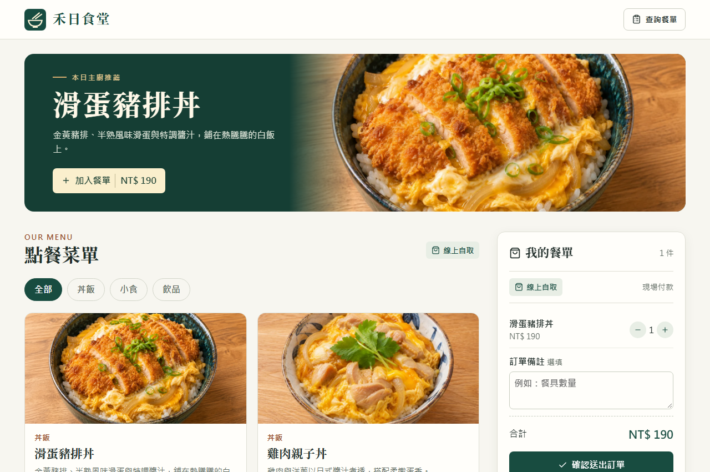

# 禾日食堂｜點餐、營運與倉庫

從點餐與金流接續備料、倉庫收發貨、盤點與物流資料。[工具入口與各模組的重跑方式](modules/README.md)。

Stockroom 支援在一筆交易內保留多個 SKU。若其中一項缺貨，該批所有保留一起回滾。補貨後可沿用原批號重試。操作人員可用批號查看各品項的到期時間、已出貨量、剩餘保留及同時點的可用庫存，整批取消後也能查回原收據。[多商品保留、現況與取消](modules/stockroom-reservations/README.md#一次保留多種商品)

出貨可從到期清單先找出仍保留、即將到期的品項。查詢與到期回收使用同一筆 SQLite 交易，支援 SKU 篩選與按截止時間續頁。[到期清單與並行測試](modules/stockroom-reservations/README.md#先列出即將到期的保留)

出貨前也可按 SKU 對照實體、可用及保留件數。查詢會先結算到期，從同一筆交易讀取匯總與各保留單，並將舊版無期限的保留分開計入。[SKU 保留來源核對](modules/stockroom-reservations/README.md#依-sku-核對目前保留來源)

部分出貨後可用新擷取的 Stockroom 快照重排剩餘箱子。排程會核對原箱號的件數、保留截止和裝車時間，並能扣除已出貨箱的已知工時。[部分出貨重排](modules/dispatch-window/README.md#部分出貨後重排)

出貨排程也可將整張訂單分派到兩座包裝台並行處理。每台可指定開工與暫停時段，訂單也可限制在有專用設備的台面包裝。排程會核對開工、保養和交運期限，並列出無法出貨的原因。[雙包裝台排程](modules/dispatch-window/README.md#兩座包裝台同時作業)

交班可按 SKU 查已到期的保留單，核對部分出貨或減量後的釋回件數，以及實際回收時間。[到期回收紀錄](modules/stockroom-reservations/README.md#查閱已到期的庫存回收)

倉庫可按實點結果調整庫存，保留已占用件數與調整前後紀錄。盤點期間若出貨或入庫改變庫存版次，須重新核對。[實點調整與稽核](modules/stockroom-reservations/README.md#核對實點後調整庫存)

同一場盤點的多個 SKU 可一起核對並入帳，任一品項不符會整批退回。[多品項盤點](modules/stockroom-reservations/README.md#一起保存多品項盤點)

已入帳的盤點批次可用新收據沖回。系統會逐項核對後續庫存異動與保留量，並保留原批次供稽核。[盤點批次沖回](modules/stockroom-reservations/README.md#沖回已入帳的盤點批次)

若出貨需要延後，可選取清單中的多張單一起續期。任一筆期限已變更時整批退回，成功後可按批號取得原續期收據。[批次續期與回滾測試](modules/stockroom-reservations/README.md#將多張保留單一起續期)

交班時可依保留編號查單張及批次續期的原期限、新期限與收據識別碼。保留到期後仍可核對歷程。[續期紀錄與續頁](modules/stockroom-reservations/README.md#按保留單查續期紀錄)

倉庫可在整車交運前預覽每箱的保留餘量、已出貨箱號與缺件數。正式登記時會重查保留，任一箱不足時整批退回。[整車交運預覽](modules/stockroom-reservations/README.md#整車交運預覽)

客人從首頁送自取單，或掃描桌牌進入該桌菜單，加購餐點、填備註並取得取餐號碼。店家在另一台裝置接單、製作、交餐或標示售完，客人的收據會自動更新。菜單以新台幣計價。自取和掃碼內用均支援 LINE Pay、全支付、街口支付、悠遊付、Pi 拍錢包、全盈+PAY、信用卡與現場付款。私人預覽的線上付款採示範模式。

點餐前台、店員接單台、餐廳營運工具與倉庫出貨流程放在同一個儲存庫。點餐網站直接使用同庫的套餐、分帳、搭配推薦與出餐估算模組。店員可用匯出的備料、分站資料及成交收據接續採購、退餐、成本或金流核對。倉庫的出貨安排則以同時點庫存快照為輸入。[系統模組與操作入口](modules/README.md)

[私人點餐預覽](https://hey-table-peca12968.peca12968.chatgpt.site) · [可列印桌牌](https://hey-table-peca12968.peca12968.chatgpt.site/tables) · [店家後台](https://hey-table-peca12968.peca12968.chatgpt.site/kitchen)



## 在購物車直接加點

加入一碗滑蛋豬排丼，開啟「我的餐單」即可看到一項可選搭配。點選加點按鈕會加入一份、更新合計，之後仍可調整數量及付款方式。自取及掃桌牌內用共用同一套購物車操作。

在「我的餐單」選「分享點餐清單」可複製一個只含品項與份數的連結。直接開啟連結會以自取餐單預覽。內用可先掃描桌牌，再選「貼上點餐清單」，由目前桌號核對菜單、剩餘份數及已選份數。貼入連結讓顧客預覽品項，桌號沿用目前頁面。確認才加入購物車，原有備註與付款選擇會保留，仍需另外確認送單。若其他分頁已有待確認餐單，系統會先保留原送單資料。[跨手機分享、桌牌掃碼與待確認送單測試](qa/cart-share.spec.mjs)

同一分享面板的「顯示清單 QR 碼」可讓同行者掃描，也可下載 GIF 圖檔。畫面上的 QR 碼會隨購物車份數更新，下載檔保存下載當下的清單。掃碼會開啟相同的清單預覽，並依接收時的供應量重新核對。QR 編碼在瀏覽器完成，私人預覽的掃碼連結仍需網站存取權。[QR 解碼、圖檔與跨手機測試](qa/cart-share.spec.mjs)

菜單搭配適用於剛開始接單的店家；累積五張已完成的餐單後，程式讀取最近 200 張已完成單（按訂單編號排序），優先從資料挑選小食或飲品。候選品須至少出現在兩張餐單，若與購物車品項也共同出現至少兩次，畫面會標示「常一起點」，其餘依人氣選出的品項標示「人氣加點」。已有或售完的餐點會從候選清單移除。缺乏合適資料時使用「菜單搭配」，也可能沒有可推薦品項。

手機整合測試在本機廚房完成三張豬排丼配煎餃、兩張煎茶。A03 桌再點一碗豬排丼，能從推薦加入 85 元煎餃，選 LINE Pay 送出總額 275 元的示範單。測試另涵蓋售完、回覆亂序與服務失敗時繼續送單。公開的推薦 API 僅回傳推薦菜色 ID 與選擇依據類別。[Menu Pairs 排名實作](modules/menu-pairs/README.md) · [購物車與 D1 測試](qa/add-on.spec.mjs)

## 在手機試用套餐折扣

在私人示範的 A03 桌各點一份豬排丼、親子丼、煎餃與煎茶，餐點原價 NT$490。勾選「套用套餐優惠」後，系統將豬排配煎茶、親子丼配煎餃，共折 NT$75。選擇全支付後可用 NT$415 完成模擬付款，收據會列出原價與折扣。展開分帳，可按各人吃的品項分配折後金額。

自取及掃碼點餐共用計價規則。優惠預設由顧客選用，只在示範模式開放。伺服器驗算價格，把成交的套餐組合與逐菜折扣一起寫入 D1。即使餐點後來售完，重送相同訂單仍取回原收據。舊單沿用原價分帳。[套餐計價](lib/combo-pricing.mjs) · [手機結帳與重送測試](qa/combo.spec.mjs)

## 匯出收據給店員試算退餐

店員在接單台開啟「匯出退餐試算收據」，輸入取餐號碼查詢計價明細。已超過近期結單清單的舊單也能依號碼查回。核對餐點、原單金額與套餐折抵後，按「下載試算收據 JSON」。匯出檔包含餐單編號、成立時間、品項、數量、定價及成交時的套餐分攤；備註、桌號和支付資料留在點餐系統。

查回原單後可輸入想試算的份數，查看單點與套餐份數的折後單價、這次金額和餘額。按「記入試算紀錄」可保存這筆資料，換一台店員裝置也能查回。兩份煎餃中，第一份單點可登記 85 元，下一次試算其餘一份就會依套餐實付計為 72 元。瀏覽器與伺服器依原收據的折扣分攤試算，伺服器在 D1 確認預覽的金額與試算簿版本後寫入。本次回應遺失可重送原操作，取回同一筆紀錄。試算簿記錄的是店家試算。原收據也可下載給離線工具使用。[跨裝置、並行及舊收據測試](qa/return-receipt.spec.mjs)

誤登時可在試算紀錄選「更正」，填寫原因並確認撤銷。原金額、份數與登記時間會和撤銷原因及時間一併保留。撤銷只恢復該筆使用的份數與實付金額，例如撤銷 85 元的單點煎餃後，72 元的套餐份數仍已登記，下一次試算會取用原本的 85 元。撤銷與新增共用試算簿版本，回應遺失時可重試原撤銷。[版本競爭、手機重試及恢復原單價測試](qa/return-receipt.spec.mjs)

「退餐試算交班」按台灣異動日期列出登記、撤銷與當日淨異動。昨天登記、今天撤銷的餐單會分別列在兩天。畫面提供同一份擷取結果的列印及 JSON 下載，點餐號可直接開啟完整試算簿。交班金額對應試算簿的異動。[跨日、手機匯出與餐號連結測試](qa/return-receipt.spec.mjs)

核對異動後可確認這份報表並選填交班備註。確認保存當時的異動筆數與淨額；同一天後續新增登記或撤銷時，下一次擷取會提示重新核對。重新送出相同報表與備註會沿用原確認時間。報表確認與備註只供通過店員驗證的裝置查閱。[並行寫入與回應遺失測試](qa/tappay.test.mjs) · [手機交班確認測試](qa/return-receipt.spec.mjs)

「查看完整確認紀錄」依同一台灣日期每頁列出 10 筆。翻往較早紀錄時，以前一頁最後一筆為界，同時新增的確認會在回到最新頁時顯示。從列表開啟封存報表後可返回同一頁。[分頁邊界和日期隔離測試](qa/tappay.test.mjs) · [手機開啟與返回測試](qa/return-receipt.spec.mjs)

確認紀錄可開啟當時核對的逐筆報表，列印或下載該版 JSON。後續新增或撤銷的試算會留在當日交班，歷史頁面保留確認當時的項目。新確認在同一筆 D1 交易保存擷取時間、備註和逐筆快照。舊確認會比對原本的指紋，只有能完整核對的版本才提供報表。[同一時間異動、確認回滾與舊版測試](qa/tappay.test.mjs)

可在 Demo 總站切換早班確認、撤銷後的當日交班與封存報表。此範例使用合成餐單，由 `node scripts/return-ledger-demo.mjs` 執行實際報表、撤銷與封存邏輯重建。[退餐交班試玩（私人預覽）](https://peca-github-demo.peca12968.chatgpt.site/?demo=returnLedger#demos) · [測試資料](examples/return-ledger-demo.json)

在 Receipt Returns 專案內執行 `python returns.py local.db import 下載的收據.json`。例如 A03 桌用全支付模擬結帳 345 元，其中兩份煎餃合計 157 元。依試算工具的規則先登記單點的一份 85 元，再試算套餐內的另一份 72 元。原單付款狀態維持已付款；這項操作只登記本機試算。[Receipt Returns 操作說明](modules/receipt-returns/README.md) · [手機下載與 CLI 整合測試](qa/return-receipt.spec.mjs)

## 替個別餐點加備註

掃碼內用、線上自取及店員代建自取都可展開「品項備註」。例如在煎餃填「醬另外放」，煎茶填「分兩杯」。每則最多 80 字，套用到該品項的全部份數。整張餐單的餐具或包裝需求可填在「訂單備註」。

送單時，備註與餐點一起保存。斷線重送可找回原餐單，若用同一送單識別碼更改任一品項的備註，伺服器會拒絕。顧客收據、接單台與交餐小票會把備註列在對應餐點，分站看板和 Pass Rail 出單僅帶本站品項的備註。再次點餐會加入品項與份數，新餐單可重新填備註。[手機與 D1 測試](qa/item-notes.spec.mjs) · [分站 HTML 整合測試](modules/pass-rail/kitchen-demo.mjs)

## 用兩台裝置試點一單

店員可在「管理接單管道」選擇 A01 至 A08 的單桌設定。例如，暫停 A03 清潔期間的新餐單，A04 顧客仍可掃碼，線上自取也照常。A03 已成立的餐單可繼續付款、製作和交餐。顧客在暫停期間仍能編輯購物車，恢復後可直接送出。

單桌與整個掃碼管道各有設定，兩者都開放才接受該桌新單。資料庫在寫入訂單時一併檢查設定。兩台店員裝置用同一版本修改同一桌時，後到的更新會要求重新載入。[店員與手機整合測試](qa/intake.spec.mjs)

自取與掃碼內用的購物車會在餐點或份數改變後自動顯示預估出餐時間，亦可按「重新試算」讀取最新廚房狀態。試算假設目前的餐單接在製作中餐單之後，把各站尚在製作的餐點按完整批次計算。初始工時採示範值，店員可匯入校準結果。估算尚未納入鍋中進度與店家接單前的等候時間。

一個可重跑的案例是熱台正在做三碗親子丼及兩份唐揚雞，飲品台正在做兩杯煎茶。此時加點一碗親子丼約需 11–14 分鐘；第一張單出餐後重新試算，降為 4–5 分鐘。購物車只收到試算時間及秒數區間。試算不建立餐單或付款，廚房備註及其他餐單資料留在後端。[Pickup Window 排程](modules/pickup-window/README.md) · [瀏覽器與 D1 測試](qa/cart-quote.spec.mjs)

1. 在 `/tables` 列印 A01 到 A08 桌牌。掃描 A03 後，菜單與收據顯示「A03 桌內用」。從首頁開啟則預設線上自取。託管預覽與桌牌連結都需有網站存取權。
2. 加入滑蛋豬排丼 NT$190，可增減數量、加備註，再確認送單。保留收據連結即可查這張餐單；同一裝置也能從「查詢餐單」找回最近一單。
3. 店主在 `/kitchen` 接單，依序切換製作中、可取餐、已完成。待接單時也能取消。收據每五秒更新一次，可手動更新。後台可暫停售餐，再恢復供應。

### 忙碌時暫停其中一個接單管道

店員在接單台開啟「管理接單管道」，可分別暫停或恢復「掃碼內用」與「線上自取」。顧客會看到暫停通知，仍可瀏覽、修改和保留購物車。恢復後可送出原購物車。暫停前已成立的餐單可重送取得原收據，也能繼續付款、製作和交餐。

接單狀態與建立訂單在同一個 D1 批次內檢查。兩名店員若同時操作同一管道，舊版本會被拒絕並提示載入最新狀態。這次遷移會讓既有店家從兩個管道均開放開始。手機測試涵蓋已開啟的舊菜單、暫停後重新進站、保留備註、恢復送單，以及暫停與八筆新單在 D1 併發時的一致性。[手機與 API 測試](qa/intake.spec.mjs)

## 把量測到的工時套用到購物車

在店家接單台開啟「管理出餐工時」，下載目前設定。將這份檔案交給 Batch Clock 的 `calibrate --format kitchen`，再把產出的 JSON 匯回接單台。頁面會列出有變動的餐點及新舊秒數。按「套用工時」後，下一次購物車試算就會使用新設定。可預覽並套用上一版，亦可還原示範工時。[Batch Clock 使用說明](modules/batch-clock/README.md)

每次套用均比對店員開啟時的版本。若另一人已先儲存，請載入最新工時再選檔比較。匯入檔保留現有菜單、分站、工作位數與批量，只能調整每批最短和最長秒數。整合測試用瀏覽器下載設定，再用真正的 Batch Clock CLI 校準合成煎茶資料。飲品台空閒時，三杯煎茶的預估由 120–180 秒變為 96–170 秒，還原後回到原區間。[店員與購物車整合測試](qa/batch-clock.spec.mjs)

## 試一次線上付款

加入餐點，在餐單選擇付款方式，送單後從收據按「開始模擬付款」。可試成功、失敗或取消；失敗與取消後可以重新付款。待確認期間重按只會開啟原交易。店員在接單台能辨識示範單；線上單須取得授權或付款成功才可製作。顧客未開始付款時，店家可取消餐單。廚房取消餐單與金流退款各自有獨立狀態。

已模擬付款的餐單可由店員執行「模擬全額退款」。確認前會顯示金額與餐單影響。未交餐時，D1 在同一筆交易更新付款及取消餐單，釋回預約或每日限量份數；交餐後則保留原交餐紀錄。顧客在原收據查看退款結果，未交餐的取餐 QR 碼會收起。此操作限示範模式，沒有實際退款。[交易回滾和時段回收測試](qa/tappay.test.mjs) · [手機退款測試](qa/payments.spec.mjs)

接單台的「示範退款紀錄」按台灣退款日期列出退款時間、餐號、支付方式、原交餐狀態與金額，可列印或下載同一份查詢結果。新退款與紀錄在同一筆 D1 交易保存，同一次操作重送仍沿用原退款時間。舊取消單可從進度找回退款時間；較早已交餐後退款的餐單若缺少時間，仍可從收據查付款狀態。[跨日退款與舊單測試](qa/tappay.test.mjs) · [手機交班下載測試](qa/payments.spec.mjs)

店員可點退款餐號查看原餐單品項、退款前後狀態與資料來源，或輸入餐號查沒有退款日期的舊餐單。沒有保存的時間會顯示未記錄。明細可用同一份快照列印與匯出 JSON，返回時保留原先的報表日期。

顧客可以在原餐單的付款區查看退款時間，並下載 UTF-8 文字收據。檔案包含原取餐號碼、支付方式、退款金額和台灣時間；缺少時間的舊單會標示「未記錄」。下載沿用原收據的查單憑證，檔案不含查單憑證、付款參考號或餐單備註。[顧客退款下載測試](qa/payments.spec.mjs)

### 從接單台匯出付款對帳快照

店員在接單台展開「匯出付款對帳快照」，選擇商戶測試或正式金流，再下載 JSON。檔案僅含付款嘗試的參考號、金流交易號、商店編號、建立時間、狀態，以及餐單編號、支付方式和總額。選定環境的歷史付款嘗試會一起匯出，讓今天的退款仍可對回舊餐單。

日結與跨日退款工具可直接用 `--restaurant-snapshot` 讀取該檔案，並搭配相同環境的金流紀錄核對。匯出上限為 5,000 筆付款嘗試，超過時可用 SQLite 備份核對完整範圍。站內示範單不在匯出範圍。[Payout Ledger 操作說明](modules/payout-ledger/README.md#從接單台匯出的快照開始) · [API 到對帳報表的整合測試](qa/tappay.test.mjs)

### 登記現金收款與找零

餐點備妥後，店員可在接單台或掃碼交餐畫面展開「登記現金收款」，輸入實收的整數金額，核對找零後確認。已交餐的現場付款單也可補登，原本的交餐動作仍可獨立執行。確認會核對餐單原價，每張餐單只建立一筆收款紀錄。斷線後可重試同一筆操作，顧客也能從原收據核對應收、實收與找零金額。[手機收銀與重試測試](qa/payments.spec.mjs) · [D1 並行收款測試](qa/tappay.test.mjs)

發現實收金額輸錯時，店員可展開「更正現金收款」，核對找零並填寫原因。每次更正保留原實收、修正金額和時間，顧客收據顯示最新金額。更正後的實收與找零回到原收款登記日，淨收仍以餐單原應收計算。已保存的盤點版本保留當時資料，重新核對最新收款後可保存新版。[更正與日結並行測試](qa/tappay.test.mjs) · [手機更正流程](qa/payments.spec.mjs)

### 核對現金日結

接單台的「現金日結」依台灣時間的收款登記日期列出實收、找零和淨收。補登按實際登記日列入。店員可輸入開班現金、其他現金淨額及實點收班現金，核對計算出的盤點差額。下載 JSON 會包含畫面上的同一份收款資料，以及已填齊的盤點數字。系統以十進位字串保存匯出合計與盤點金額，在整數加總超過 JavaScript 安全整數範圍時仍能保留精度。[日期邊界與精度測試](qa/tappay.test.mjs) · [手機盤點與匯出測試](qa/payments.spec.mjs)

收款明細會顯示跨日餐單的成立日，並用有效的交餐時間標出交餐後才登記的款項。「當日現金更正」依更正日列出版本和前後實收，可返回原收款日核對。日結與更正活動從同一份 D1 讀取快照擷取並一起下載，盤點版本仍按原收款日保存。API 支援加上 `activity=1` 取得收款脈絡與更正活動。

金額核對後可按「保存盤點版本」，將當時的收款明細與盤點差額留存。保存時會再次核對收款筆數和上一版。期間若出現新收款或另一位店員先保存，須用最新資料核對。後續保存會建立新版本，各版均可依日期下載，包含當時的盤點金額、資料擷取與保存時間。[並行保存與重送測試](qa/tappay.test.mjs) · [手機更正與舊版下載測試](qa/payments.spec.mjs)

## 每日訂單摘要

店員可從接單台開啟「每日訂單摘要」，按台灣日期查詢當天成立的餐單。摘要分開統計自取與掃碼內用，並依實際交餐狀態加總份數。金額以已交餐單的成交金額計算，包含示範單及當時的套餐折抵。按「下載摘要 JSON」可保存畫面上的同一份快照。日期範圍從台灣時間當日 00:00 起算，到隔日 00:00 前。[台灣日期邊界測試](qa/tappay.test.mjs) · [手機匯出測試](qa/ordering.spec.mjs)

「已交餐付款方式摘要」沿用台灣成立日期，把已交餐單按付款方式與正式、測試或示範環境分列。在同一份 D1 快照讀取原成交金額、最新付款狀態與現金登記。待核對清單列出缺現金登記、待請款、待確認及其他需核對的餐號。點餐號即可開啟當天的已交餐單，查閱付款狀態或補登現金。較早的餐單也能直接查閱，返回後會重新擷取原日期的摘要。畫面、列印及 JSON 下載使用同一份結果，API 可加上 `paymentSummary=1` 取得。實收與找零可從現金日結按登記日核對。[付款狀態與日期測試](qa/tappay.test.mjs)

接單台的「線上付款待核對」跨日顯示仍在確認或已授權待請款的最新付款嘗試，包含已交餐但仍待請款的餐單。店員可以依付款方式、狀態及環境篩選，從付款開始最早的餐單查起，並切到餐單明細後返回相同條件。清單標出已達保留時間的待確認交易，並顯示最近一次發出查詢的時間。若環境允許呼叫金流查詢，店員可直接核對並更新清單。[跨日、分頁與最新付款嘗試測試](qa/tappay.test.mjs) · [手機付款核對測試](qa/payments.spec.mjs)

「待核對交班匯總」依所選付款工具、狀態與環境統計完整清單，翻頁仍會顯示符合該篩選的所有付款。查詢以同一份 D1 快照讀取清單和匯總。金額以原餐單金額計算，下載 JSON 保留十進位字串精度、篩選條件和擷取時間。摘要不含餐號、備註與金流參考號。[匯總精度與手機下載測試](qa/tappay.test.mjs)

「比較付款交班摘要」可選取上一班下載的 JSON，和目前擷取結果比對。兩份摘要必須使用相同付款工具、狀態及環境篩選。畫面顯示兩次擷取時間、整體差異及有變動的付款分組，並保留整數金額精度。檔案在瀏覽器讀取，重新擷取時可沿用同一份摘要。[手機下載與匯入測試](qa/payments.spec.mjs)

從待核對清單或餐單明細開啟「付款交班備註」，可替目前待確認或待請款的嘗試留下進度。儲存時核對同一筆付款嘗試及狀態；連線中斷可重送原備註。清單顯示當前嘗試的最近備註。付款完成或顧客重新付款後，原備註仍可從餐單明細分頁查閱。[重送、狀態變更與手機交班測試](qa/payments.spec.mjs)

餐單明細的「歷次付款嘗試」每頁列出 10 筆，依嘗試順序顯示最近記錄的狀態、開始時間及已記錄的金流查詢與首次可接單時間。可直接開啟某一次付款的備註；曾失敗或已結案的嘗試均可查閱。店員可以在最新且待核對的嘗試新增備註。[並列失敗與成功嘗試測試](qa/payments.spec.mjs) · [分頁、同時重試與權限測試](qa/tappay.test.mjs)

Demo 總站可試玩跨午夜待核對、留下備註、原操作重送與付款後查回歷程。使用 `node scripts/payment-attention-demo.mjs` 可依合成餐單執行實際查詢、備註寫入與示範付款流程，重建同一份資料。[付款交班試玩（私人預覽）](https://peca-github-demo.peca12968.chatgpt.site/?demo=paymentAttention#demos) · [範例資料](examples/payment-attention-demo.json)

摘要也會按自取與內用分開顯示製作及交餐等候時間。製作是接單到餐點備妥，交餐等候是備妥到交付。統計列出具備兩端時間的餐單數、中位數及第 90 百分位數。第 90 百分位數取排序後第 ⌈0.9 × 樣本數⌉ 筆。缺少或順序不合的時間只計入候選餐單總數。跨午夜的餐單仍依成立日期歸屬；API 可加上 `timing=1` 取得毫秒統計。[耗時與舊資料測試](qa/tappay.test.mjs)

「自取到店後等候」以台灣到店日期歸屬，擷取到店回報到交餐的實際時間。可比較到店時已備妥、尚未備妥與全部等候的中位數和第 90 百分位數。缺少有效備妥時間的樣本仍計入合計，跨午夜交餐也留在原到店日。畫面、列印及下載摘要沿用同一份快照。[到店日與樣本邊界測試](qa/tappay.test.mjs)

「預約自取備妥準時率」按台灣取餐日期和目前預約時段統計。備妥時間在時段截止前或同一刻都算準時。分母包含準時備妥、逾時備妥，以及擷取時已過截止仍未備妥的餐單。未到截止、缺時間、不符付款條件與取消的餐單會另列。可點選異常餐號開啟原預約。摘要、列印與 JSON 共用同一次擷取，JSON 的異常清單只含餐號、狀態與備妥時間。API 可加上 `pickupPunctuality=1` 取得資料。[時段與付款邊界測試](qa/tappay.test.mjs) · [手機核對與列印測試](qa/ordering.spec.mjs)

已交餐品項分列自取、掃碼內用與合計份數。按「下載份數 CSV」可把所選日期的品項統計帶到試算表，檔案沿用畫面上的份數及擷取時間。API 可加上 `itemChannels=1` 取得分管道份數。[分管道與日期邊界測試](qa/tappay.test.mjs) · [手機下載測試](qa/ordering.spec.mjs)

交班時可按「列印交班摘要」。列印沿用畫面上的日期、台灣擷取時間、餐單狀態與金額、製作及交餐耗時、各管道品項份數。換日期後須完成查詢才會顯示對應的列印與下載操作。開著預設的今日摘要跨過台灣午夜時會自動改查新日期，手動查詢日期則會固定在所選日期。[行動版列印與午夜切換測試](qa/ordering.spec.mjs)

## 每日限量供應

店員可從接單台開啟「每日限量供應」，依台灣日期設定各品項總份數。空白表示不限量，0 表示當日停止供應。自取與內用共用上限，已成立餐單會占用份數，取消後釋回。若上限低於已占用量，菜單會顯示售完，直到加量或取消釋出。手動標記售完也會阻擋送單。

顧客在菜單可看到限量品項的剩餘份數。送單會在同一筆 D1 寫入比對份數，避免同時搶最後一份時超賣。已成功餐單用原送單識別碼重試會取得原收據。店家編輯也會比對載入時的設定版本。[限量供應併發測試](qa/intake.spec.mjs)

切回菜單或恢復連線會重新檢查供應。若購物車超過可售份數，可按「查看份數調整」，預覽減量、移除，或選相同分類的餐點補足缺少份數。預覽會列出調整後的合計並核對購物車內已選份數。若替代餐點的供應更新，須重新核對。保留品項的備註、訂單備註及付款選擇會沿用。新餐點可在品項備註填寫需求。確認調整後仍須另外送單。[手機換餐、斷線與 D1 訂單測試](qa/intake.spec.mjs)

Demo 總站的「缺貨換餐」可演練替代餐點售罄、重新核對和送單。執行 `node scripts/cart-supply-review-demo.mjs` 會以實際供應 API 和購物車規則重建預覽，驗證售罄後的舊方案遭拒，並從點餐 API 讀出重選後的收據。[缺貨換餐試玩（私人預覽）](https://peca-github-demo.peca12968.chatgpt.site/?demo=cartSupplyReview#demos) · [範例資料](examples/cart-supply-review-demo.json)

有限量的品項可從卡片展開「補貨增加可售份數」。新上限以原上限和目前已占用量中較大者為基礎，再加上補貨份數。即使店員先把上限調為 0，補貨也會讓相應份數重新可售。手動售完標記仍需由店員解除。兩個店員從同一版次補貨時只會接受一筆，斷線可從同一瀏覽器分頁重試。D1 保存當時的原上限、占用量和新版上限，重送已成立的操作會取回原結果。[手機、斷線與並行補貨測試](qa/intake.spec.mjs)

「查看供應變更紀錄」按當前供應日期與品項列出手動儲存、跨日複製和補貨，顯示台灣時間與上限前後。跨日複製附來源日期，補貨附新增份數與當時占用量。手動與跨日複製從紀錄啟用後開始保存，既有補貨會直接列入。切回不限量後仍可查閱，亦可切到「只看補貨」。每頁最多 25 筆，依版次續頁，下載 JSON 與畫面相同。[日期、權限與分頁測試](qa/tappay.test.mjs) · [手機歷程與匯出測試](qa/intake.spec.mjs)

選擇「還原變更前上限」會先顯示目前上限、欲還原的值及已占用量。確認後以所選紀錄的原上限建立一個新版本，原紀錄和已成立餐單保留。兩位店員從同一版本同時還原或編輯時，只會成立一筆。若沒有可售份數，菜單會暫停該品項的新單。[手機還原與併發測試](qa/intake.spec.mjs)

準備另一天的供應時，先選目的日期，再展開「從其他日期複製上限」。讀取來源後可比較有差異的品項、目的日已占用量與停供影響，勾選確認後一次套用。D1 同時核對所選品項的來源與目的版次，有任何過期資料時整批退回。複製的是選定的上限，原日期、已成立餐單與補貨紀錄可繼續查閱。[手機比較與並行儲存測試](qa/intake.spec.mjs)

### 串接 TapPay 商店

付款後切回收據，或裝置恢復連線時，頁面會重新查詢原交易。測試讓 LINE Pay 與全支付的模擬金流在收到付款請求後斷線。第一次查無紀錄時保留「付款確認中」，同時重送八次仍只發起一次金流請款。待交易紀錄可查後，原收據會顯示已付款。[交易中斷測試](qa/tappay.test.mjs) · [收據恢復測試](qa/payments.spec.mjs)

送出付款後如果收據沒收到回覆，會先用原餐單查回付款紀錄。查回待確認的交易後，可繼續該次付款。若明確查到沒有付款紀錄，會重新開放付款按鈕。查詢仍中斷時，可按「向金流查詢狀態」再查。手動查詢會顯示本次核對結果及目前付款狀態。[手機斷線復原測試](qa/payments.spec.mjs)

Demo 總站的「付款斷線復原」可切換請求已送達或未送達兩種情境，核對同一餐單的送出次數與已建立的付款筆數。使用 `node scripts/customer-payment-recovery-demo.mjs` 可透過點餐、查詢及示範付款 API 重建資料。[付款復原試玩（私人預覽）](https://peca-github-demo.peca12968.chatgpt.site/?demo=customerPaymentRecovery#demos) · [範例資料](examples/customer-payment-recovery-demo.json)

可用手機點一份滑蛋豬排丼和一杯煎茶，勾選套餐優惠後合計 NT$200。選悠遊付、Pi 拍錢包或全盈+PAY 送單，在收據先試「模擬取消」，再重新付款。重新整理仍可看到同一筆訂單的已付款狀態。[手機付款測試](qa/payments.spec.mjs)

私人預覽預設使用本機示範資料，不連線到金流商、不收款、不收集卡號。串接程式分成 SDK 取得一次性 prime、伺服器用訂單金額發起付款、Record API 查證交易三步。卡號、安全碼與到期日輸入在 TapPay 的託管欄位。付款人的聯絡資料只在該次請求送至金流商，應用程式不寫入資料庫。

| 部署環境設定 | 用途 |
| --- | --- |
| `TAPPAY_MODE` | 預設 `demo`。商店測試用 `sandbox`，正式環境用 `production`。 |
| `TAPPAY_APP_ID`、`TAPPAY_APP_KEY` | 同環境的前端 SDK 設定，依 TapPay 商店後台設定網站網域。 |
| `TAPPAY_PARTNER_KEY` | 僅限伺服器的機密設定。 |
| `TAPPAY_MERCHANT_LINE_PAY`、`TAPPAY_MERCHANT_PX_PAY_PLUS`、`TAPPAY_MERCHANT_JKO_PAY`、`TAPPAY_MERCHANT_CARD` | 各付款方式已開通的商店編號。只顯示有完整設定的方式。 |
| `TAPPAY_MERCHANT_EASY_WALLET`、`TAPPAY_MERCHANT_PI_WALLET`、`TAPPAY_MERCHANT_PLUS_PAY` | 依序設定悠遊付、Pi 拍錢包及全盈+PAY 的商店編號。全支付與全盈+PAY 可分別開通。 |
| `TAPPAY_SITE_ORIGIN`、`TAPPAY_NOTIFY_URL` | 顧客返回的 HTTPS 網站，以及 TapPay 能從外網 POST 到的後端通知網址，處理路徑為 `/api/payments/notify`。私人 Sites 的外部登入限制也適用於通知網址，可在獨立測試部署驗證通知。 |

返回網址及通知內容只用於找到交易。伺服器以商店、幣別、銀行訂單號查詢金流，核對交易識別碼、支付方式、餐單金額及交易狀態。收據與店員都能重新查詢。店員按「查詢金流」後，餐單會顯示本次核對結果、查無可核對紀錄、環境無法查詢或暫時需等待等情況，再載入目前的付款狀態。同一付款嘗試的短時間重送會共用查詢間隔，較早回來的查詢若已被新版查詢取代，就不會改寫狀態。授權、已付款、部分退款與全額退款各有獨立顯示。若金流逾時且查無紀錄，訂單保留「付款確認中」，可使用店家金流後台核對。退款由商店在金流端辦理，再回本站查詢結果。[查詢結果與併發測試](qa/tappay.test.mjs) · [手機金流查詢](qa/payments.spec.mjs)

整合測試使用本機替身驗證 TapPay 請求與回應，實際商戶驗收仍需各支付方式的測試資格。[TapPay 全支付](https://docs.tappaysdk.com/px-pay-plus/zh/home.html) · [後端 API](https://docs.tappaysdk.com/px-pay-plus/zh/back.html) · [付款狀態](https://docs.tappaysdk.com/px-pay-plus/zh/reference.html) · [官方 Web SDK 範例](https://github.com/TapPay/tappay-web-example)

前端依錢包使用對應的 SDK 模組取得一次性付款憑證。伺服器送給 Pi 拍錢包的商品明細取自訂單快照，逐項列出品名、數量及單價。查詢交易時同時比對錢包代碼，即使交易編號與金額相同，另一個錢包的紀錄也無法把訂單改成已付款。[悠遊付 SDK](https://tappay.github.io/tappay-web-example/Easy_Wallet/) · [Pi 拍錢包明細規格](https://docs.tappaysdk.com/pi-wallet/zh/reference.html#details) · [全盈+PAY SDK](https://tappay.github.io/tappay-web-example/Plus_Pay/)

結帳會保留顧客原選的付款方式。若下線，顧客可在同一份餐單改選可用方式，餐點、備註及取餐時段會一起保留。同一付款方式切換到另一個金流環境時，需確認目前環境後才能送出。伺服器在建立新餐單前核對前端確認的環境；已成立餐單以原識別碼重試仍可取回原收據。[付款環境與舊單重試測試](qa/tappay.test.mjs) · [手機結帳測試](qa/payments.spec.mjs)

已送出的線上餐單若還在待接單、付款保留未到期，且從未開始付款嘗試，可在原收據確認改用現場付款。D1 在同一筆操作更新付款方式，保留餐號、品項、金額及預約時段，也記下原付款方式和變更時間。開始線上付款與改付現金只能先成立其中一項。接單等候時間從改付成功起算。[切換付款與並行測試](qa/tappay.test.mjs) · [手機收據與接單測試](qa/payments.spec.mjs)

## 送單時斷線，如何找回收據？

在同一台裝置、同一個瀏覽器開啟「查詢餐單」，選取待確認的自取或桌號。也可以重新掃同一張桌牌。頁面會用上次送單的識別碼查詢廚房。若廚房已收到，直接開啟原收據。若尚未找到，可按「重試同一張訂單」沿用原本的品項、備註與識別碼送出。送單回覆超過 15 秒時，頁面會保留原餐單並立即查詢。查詢超過 10 秒時，可以按「重新查詢送單結果」，切回點餐頁或恢復連線也會重查。只有按下重試才會再次送單。

待確認的餐單保存在瀏覽器裡，各桌與自取分開保存。此功能需要瀏覽器允許本站儲存資料。端對端測試會讓本機 Worker 真正寫入訂單，再刻意丟掉回應並關閉分頁，核對重開後的取餐號碼、廚房訂單數及實際送單請求次數。另測試送單未達、查詢服務暫時失敗、重試時售完，以及舊版裝置草稿的恢復。

支援 Web Locks 的瀏覽器會依自取或桌號同步送單識別碼。兩個分頁同時確認同一份餐單時，後續分頁會查回先送出的餐單。原餐單確認送出後，仍開著的舊分頁也會開啟原收據。重新開啟空餐單後，可照常送出下一張訂單。[多分頁送單測試](qa/ordering.spec.mjs)

## 收據進度

顧客可在原查單頁按「下載餐單明細」，留存 UTF-8 文字檔。檔案含台灣時間、各品項單價和小計、套餐折抵、原餐單金額與擷取時的付款狀態，也會帶入已登記的現金實收與找零，或當筆示範退款資料。下載使用原查單憑證，備註、付款參考號與憑證留在系統內。付款保留在下載前到期時，檔案會依最新取消狀態產生。[明細權限與付款狀態測試](qa/tappay.test.mjs) · [手機下載與重試測試](qa/ordering.spec.mjs)

自取及掃碼內用的顧客可在收據查看送單、店家接單、備妥及交餐時間。若店家取消，收據會顯示取消時間。時間以台灣時區呈現，頁面每五秒更新一次，也可以按「更新進度」。

廚房比對舊狀態時，會用同一個 SQLite 更新寫入新狀態與時間。兩位店員同時操作時只有成功的一筆會寫入。舊餐單仍可查詢，能確認的舊狀態會標示「時間未記錄」。收據持有者才可查閱進度，付款仍有自己的狀態。[收據進度示範資料](examples/receipt-progress.json)

使用原收據憑證查詢 `GET /api/ticket?progress=1` 可取得 `statusHistory`。既有的查單與退餐工具仍可使用原本的回應格式。

店家接單後，自取與內用收據會顯示目前廚房排程的出餐區間。區間按此單及排在前面的製作中餐單，以完整批次與工作站容量試算。前單備妥時會重新估算，餐點備妥後收起區間。API 使用同一批資料庫查詢取得狀態與估算依據。`timing=1` 只加回本單的估算秒數、時間和工時來源。[收據排程測試](qa/cart-quote.spec.mjs)

「查詢餐單」會列出此瀏覽器最近 8 張已確認送單的收據，可按取餐號碼、桌號或自取方式辨認。其他分頁送單後清單也會更新。舊版留下的最後一筆會在查單成功後加入。移除清單上的紀錄只會變更這個瀏覽器的查單資料。[本機收據紀錄測試](qa/ordering.spec.mjs)

店家接單前，顧客可在收據確認取消現場付款單，或未付款、付款嘗試已失敗或取消的線上單。取消會寫入進度並釋回每日限量份數。付款確認中、已授權或已付款的餐單須由店家協助處理。取消與啟動付款使用同一張餐單的原子條件；取消回覆遺失時，可更新收據或重試原操作。[顧客取消、斷線與付款競爭測試](qa/payments.spec.mjs)

新成立的線上單會保留 15 分鐘，收據顯示付款期限。期限到達後，菜單、查單、結帳或店家查看營運資料時，系統會取消符合條件的餐單並釋回限量份數。仍在付款確認中、已授權或已付款的餐單會保持原狀。付款嘗試晚於期限才確認失敗或取消時，後續查詢即可釋回。上線前的舊單沿用原流程。收據的 `progress=1` 會一併傳回新單的付款期限與到期取消原因。[資料庫時間邊界測試](qa/tappay.test.mjs) · [手機收據測試](qa/payments.spec.mjs)

## 同桌分帳

在手機收據展開「這張餐單怎麼分帳？」，填寫用餐人稱呼，替每道菜指定分攤份數。同桌平分填 1，沒吃填 0，分食份量不同也可填 2 比 1。每道菜的小計與每人應付都以整元顯示。例如 190 元豬排丼歸小安，85 元煎餃和 55 元毛豆兩人平分，最後小安付 260 元、小岑付 70 元。

收據使用固定版本的 Table Shares 瀏覽器模組，在裝置上計算。分攤草稿按餐單保存在目前瀏覽器分頁，重新整理後可接續編輯。已取消的餐單會收起分帳功能。[A03 手機分帳畫面](docs/bill-shares.png) · [瀏覽器模組](modules/table-shares/split.mjs)

## 在接單台找餐單

切到「待交餐」後，可選線上自取、全部內用，或指定桌號。取餐號碼會精確比對，例如輸入 0007、#0007 或全形數字皆可找到同一張餐單。管道、桌號與取餐號碼會和狀態分頁一起篩選，店員完成交餐後可切到「含近期結單」核對結果。[手機接單台測試](qa/ordering.spec.mjs)

「逾時」會列出等候時間已達門檻的餐單，依超過門檻的時間排序。待接單為 5 分鐘、製作為 15 分鐘、待交餐為 10 分鐘。現場付款單從成立時開始等候接單，線上單從系統第一次查證可接單的付款狀態起算。製作及待交餐各用實際狀態變更時間。無可用時間紀錄的舊單只顯示一般餐單狀態。讀取失敗時，接單台會收起逾時提示並顯示連線狀態。[門檻與付款時間測試](qa/tappay.test.mjs) · [手機排序與斷線測試](qa/ordering.spec.mjs)

店員可從接單台選「查詢餐單紀錄」，以完整餐號開啟內用、自取、已交餐或已取消的餐單，涵蓋超出近期結單清單的舊單。畫面可核對原品項、總額、付款狀態、已登記收款、餐單進度及已記錄的分站、換桌和改期。舊單缺少時間時顯示「時間未記錄」。分站批次紀錄中的餐號可直接開啟明細，再回到原查詢。店員查詢僅讀取資料，回應不包含顧客查單憑證或金流識別碼。[舊單與權限測試](qa/tappay.test.mjs) · [手機查詢與返回交班紀錄測試](qa/ordering.spec.mjs)

店員可在進行中的內用餐單選「更換桌號」，核對後確認。換桌會保留餐單編號及原送單識別碼，並同步到分站、顧客收據和交餐小票。顧客查看收據時，本機查單紀錄也會更新桌號。店員確認換桌與交餐時會核對桌號版本。小票開啟後若遇換桌，按列印會先更新桌號，待再次確認後才列印。[換桌、原單重試與並行版本測試](qa/ordering.spec.mjs)

「待交餐」會顯示有兩張以上餐單備妥的桌號捷徑。選一桌，核對每張餐單的號碼、餐點份數與備註，再一次確認交餐。餐單會在同一筆 D1 寫入完成。如果期間加了一張備妥餐單、有人換桌或先完成交餐，或任何一張單的付款狀態已無法交餐，系統會請店員再核對整桌。顧客收據各自保留原單號，並顯示同一個交餐時間。[手機與併發測試](qa/ordering.spec.mjs) · [退款阻擋測試](qa/tappay.test.mjs)

## 代建電話與櫃台自取單

在接單台選「代建自取單」，輸入餐點份數和備註，以現場付款建立自取單。電話預訂可選取餐日期和時段，確認後可告知客人取餐號碼、時段，也可複製收據連結。接單台、分站看板和交餐小票會標示「店員代建自取」，接單台也能按這個來源篩選。餐點備妥後，取餐號碼會出現在櫃台看板。

店員可在暫停線上自取時繼續代建，代建單仍與自助餐單共用售完與每日限量規則。若送單後斷線，同一分頁重新整理可重試原餐單並找回同一個取餐號碼。測試涵蓋送單回覆遺失、售完後重試、店員權限及兩個入口搶最後一份。[手機與 D1 測試](qa/staff-pickup.spec.mjs)

## 自取日期與預約時段

店員可從接單台開啟「七天自取預約總覽」。D1 在同一份快照回收已到期的付款保留後，列出每天的有效預約、占用份數和仍可預約、已滿額及個別停收的時段數。整日停收與線上接單暫停各有提示。可從日期直接開啟預約清單或時段設定，重新整理仍保留原日期。[總覽與手機導覽測試](qa/pickup-slots.spec.mjs)

展開「七天備料需求」可按取餐日查閱待接單與製作中未完成的自取品項。備料需求與預約占用來自同一份 D1 快照。現金與可製作的線上付款餐單會列入，已回報備妥的分站品項會扣除。UTF-8 CSV 沿用畫面上的資料與擷取時間，只包含日期、品項與份數。[備料份數與 CSV 測試](qa/pickup-slots.spec.mjs)

線上菜單和店員代建表單可選台灣時間今天起 7 天內的取餐日。每天 11:00 到 20:00，每 15 分鐘一個時段，需提前至少 30 分鐘。選未來日期時要指定時段，兩個入口共用每段預設 12 份的容量。預約單計入取餐日的餐點限量，即時自取與掃碼內用計入成立日。送單時會重新核對份數與時段，額滿時可保留原餐點與備註並重選。線上付款保留到期或餐單取消時會釋放占用份數。已成立的餐單可按原資料重送找回收據。[店員預約手機測試](qa/staff-pickup.spec.mjs) · [雙入口與跨日限量測試](qa/tappay.test.mjs)

切回預約頁或恢復連線時，線上表單與店員代建會重查已開啟的時段。若所選時段已滿、停止預約或讀取失敗，表單會保留時段、餐點與備註，並等候重查或改選後才接受新送單。已有待確認送單仍可重試原操作，此時由伺服器查回已建立的餐單或回報衝突。[跨入口時段更新與斷線測試](qa/pickup-slots.spec.mjs)

店員在接單台選「預約自取」可依時段查看餐單，取餐前 15 分鐘開始接單製作。收據、分站看板和交餐小票均顯示預約時段。待交餐的逾時計時最早從預約開始起算。[手機重選與接單測試](qa/pickup-slots.spec.mjs) · [容量、付款到期與時間邊界測試](qa/tappay.test.mjs)

在餐單進入備餐窗口前，顧客可從收據選「更改取餐時段」，店員也可在接單台依取餐號碼代為改期。兩個入口共用同一筆 D1 條件式寫入，核對版本、新時段容量與跨日目的地的餐點限量後才轉移份數。新日期額滿時原預約仍有效。原餐號、金額與付款紀錄一起沿用。店員代改會記入收據，斷線後可由最新餐單核對已成立的改期。店員接單時也會核對目前的預約版本。[並行改期與接單版本測試](qa/tappay.test.mjs) · [手機改期測試](qa/pickup-slots.spec.mjs)

顧客與店員開著改期表單時，切回頁面或恢復連線會重新檢查新時段。額滿、停收或暫時無法讀取時，畫面保留原預約和已選的新時段，待時段重新可用再確認。若已送出的改期回覆遺失，可用相同資料重試以查回結果。[雙入口與 D1 時段競爭測試](qa/pickup-slots.spec.mjs)

跨日改期的預覽會同時查目的日的時段容量與餐點限量。若某項餐點的份數不足，顧客與店員會在確認前看到品項名稱，補貨後可重新檢查同一時段。原預約的日期、份數與付款在改期成功前維持有效。[跨日預覽、補貨與並行測試](qa/pickup-slots.spec.mjs)

遇到額滿、停收或餐點不足，可按「找下一個可用日期」。系統在預約開放的七天內，找出晚於目前所選日期、能容納這張餐單的最早時段，帶入改期表單供核對。顧客或店員仍需確認送出。[跨日建議與版本驗證](qa/tappay.test.mjs) · [手機操作測試](qa/pickup-slots.spec.mjs)

顧客購物車和店員代建自取單也可用目前餐點尋找日期。選「使用此時段」會保留份數、備註與付款選擇，並載入新日期的菜單及時段供應。送出餐單時會重新核對容量與餐點限量。[新預約建議測試](qa/pickup-slots.spec.mjs)

店員可從接單台選「管理預約時段」，按日期查看各段的已占用與剩餘份數。輸入 0 暫停該時段，留空恢復預設 12 份。可提前設定未來日期，進入 7 天預約範圍後即採用設定。上限變更會保留已成立的餐單。新單與改期會在資料庫寫入時檢查最新上限，兩台店員裝置改同一時段時會核對設定版本。已停止受理預約的時段可查看占用紀錄。[店員手機測試](qa/pickup-slots.spec.mjs) · [並行關閉與送單測試](qa/tappay.test.mjs)

「批次調整時段上限」可勾選同日多個時段，預覽占用份數及原上限，再確認暫停、調整或恢復預設。若其中一段已截止或由另一位店員更新，D1 會拒絕整批，保留其他時段原設定，重新查詢後即可重選。[預覽與競爭測試](qa/pickup-slots.spec.mjs)

「查看預約調整紀錄」依取餐日列出變更前後的時段上限和整日預約狀態，並以台灣時間顯示變更時間。一次批次調整會列在同一筆紀錄，與設定一起寫入 D1。紀錄從部署後開始累積，既有設定會在下一次調整時成為變更前的值。[資料遷移與交易測試](qa/tappay.test.mjs)

店員可從紀錄預覽還原變更前的設定。確認前可核對各時段目前與目標的上限及占用份數，或整日的開放狀態。系統按原紀錄還原所有受影響時段並產生一筆附來源的新紀錄，既有預約會保留。部分時段截止或有版本衝突時，整批還原退回。[手機還原與衝突測試](qa/pickup-slots.spec.mjs)

「從其他日期複製時段上限」以相同取餐時間比較來源日與目的日，可勾選差異並核對目的日的占用份數。D1 會在寫入交易內比對兩天的版本，保留目的日的整日開放狀態與既有預約。成功後保存來源日期，也能從該筆紀錄還原。[跨日複製與預約保留測試](qa/pickup-slots.spec.mjs)

「暫停整日預約」會關閉所選日所有時段的新預約及改入，來自線上與店員代建的預約都會重新核對。已成立的餐單仍可付款、備料及交餐，掃碼內用與盡快自取依各自的接單設定。恢復時會沿用各時段的原上限與已占用份數。兩位店員同時修改同一天時，第二筆需重新核對最新版本。[整日設定與手機點餐測試](qa/pickup-slots.spec.mjs) · [D1 並行測試](qa/tappay.test.mjs)

在接單台開啟「自取預約清單」，按取餐日查看各時段的份數、餐號、來源、付款與餐單狀態。也可從「管理預約時段」直接開啟當日或指定時段的清單，頁面網址會帶入篩選，重新整理後可接續核對。已取消的餐單可展開查閱，總份數只計入有效預約。列印沿用畫面的日期、時段與擷取時間，清單只列現場核對所需欄位。[日期、時段與欄位測試](qa/tappay.test.mjs) · [手機列印測試](qa/pickup-slots.spec.mjs)

在預約清單點選餐號，可開啟單張自取預約。店員依目前餐單狀態代改時段、接單或交餐。備餐時間、付款及版本規則與接單台一致。返回預約清單時沿用原日期與時段，已結單的預約也可查閱。[手機改期與結單測試](qa/pickup-slots.spec.mjs)

預約收據可選「下載取餐行事曆檔」。線上付款須先確認，現場付款的預約可直接下載。`.ics` 檔只含店名、取餐號碼、時段與事件狀態。改期與取消會沿用原事件識別碼並提升版本，可從原收據重新下載。匯入及更新既有事件的方式依各行事曆軟體而異。[手機下載測試](qa/pickup-slots.spec.mjs) · [獨立解析器驗證](modules/pickup-agenda/calendar.test.mjs) · [iCalendar 格式規範](https://www.rfc-editor.org/rfc/rfc5545.html)

## 自取到店回報

自取單進入製作或待交餐且可出餐後，顧客可從收據按「我已到店」。系統保留首次時間，重送會取得同一筆回報。接單台的「已到店」可篩出仍在等候的自取單，備妥的餐單優先，再按回報時間排序。掃取餐 QR 碼開啟的交餐畫面也會顯示到店時間。[手機到店與交餐測試](qa/ordering.spec.mjs)

## 通知自取延誤

製作中的自取餐單可從接單台選「通知取餐延誤」，設定預計還需幾分鐘。顧客用原收據即可查看台灣時間的最新預計備妥時間，原預約時段仍照原單顯示。若預計時間已過，收據會提示餐點仍在製作。店員撤回通知時，收據恢復顯示廚房排程；餐點備妥後，通知會自動收起。

D1 把每次發布及撤回保存為獨立版本，同筆寫入核對餐單狀態、付款與目前版本。同一操作送出但未收到回應時，重試可取得首次保存的時間。[版次與截止測試](qa/tappay.test.mjs) · [手機通知與撤回測試](qa/ordering.spec.mjs)

## 分享親友代取

餐點備妥後，原訂餐人可從收據產生 30 分鐘的代取連結。親友頁面只顯示取餐號碼、時段、QR 碼、有效期限與到店時間。親友可在同一頁按「我已到店」，原收據與店員接單台會同步看到首次回報。再次產生或取消連結會使舊連結失效，交餐完成也會關閉代取。D1 保存代取憑證摘要與版本，回報時間在確認代取連結有效的同一筆交易寫入。斷線後可重試原操作。店員掃碼後仍須以店員身分開啟交餐畫面。[到期與重試測試](qa/tappay.test.mjs) · [雙裝置代取測試](qa/ordering.spec.mjs)

## 從收據再次點餐

已完成及已取消的收據可開啟「再次點餐」。確認桌號或自取管道後，菜單會列出可加入、已售完和達數量上限的品項。選擇加入後，系統會按當時菜單計價，現有備註與購物車仍可編輯，待確認送單的餐單會先保留。再次點餐只帶入品項與數量，送單仍需按「確認送出訂單」。[再次點餐的瀏覽器測試](qa/ordering.spec.mjs)

## 列印交餐小票

在待交餐或近期已完成的餐單點「交餐小票」。列印版顯示取餐號碼、桌號或自取、餐點份數、品項備註及交餐狀態。點「列印交餐小票」時會重新查詢餐單。如果其他店員已完成交餐，畫面會更新為「已交餐」並請店員再確認。列印觸發後可在瀏覽器選擇紙張與印表機。[交餐小票測試](qa/ordering.spec.mjs)

自取餐點備妥後，顧客可在收據展開「出示取餐 QR 碼」。店員用手機相機掃描，登入後即可在自取交餐畫面核對單張餐單，再按「完成交餐」。若另一位店員已先完成，畫面會重新讀取同一張餐單。較早的已完成餐單也能掃碼核對。QR 碼只有接單台網址與取餐號碼，交餐完成後顧客收據會收起 QR 碼。[掃碼交餐測試](qa/ordering.spec.mjs)

## 廚房備料單

店員若要按工作站出單，可到接單台按「下載分站出單檔」。下載會重新擷取完整接單清單，涵蓋處理中的訂單和最近 20 張結單。檔案包含分站製作所需的桌號、品名、份數、備註與狀態，可交給 Pass Rail 匯入；只有製作中的訂單會建立分站單。接單台目前顯示的頁籤不影響匯出範圍。[Pass Rail 操作範例](modules/pass-rail/README.md)

店員也可在「分站看板」選熱台、冷台或飲品台，查看本站餐點。歷史菜單中缺少分站設定的品項會列在「其他餐點」。各站按「本站已備妥」後，最後一站會在同一個資料庫交易將餐單切為「可取餐」。第一次回報會保存該單的分站，重試沿用原回報時間。開始分站回報後，請在看板完成其餘工作站。購物車與收據的出餐估算會扣除已備妥的品項。[分站看板與並行回報測試](qa/ordering.spec.mjs)

同一工作站可勾選 2 至 20 張餐單，核對品項、份數、備註和桌號後批次回報備妥。D1 在同一筆更新核對所選餐單並保存本站進度。若任一張已有人回報、移桌或已無法製作，整批都會保留原狀，請回到看板重新核對。其他工作站已回報的進度會保留，所有站完成的餐單會同步轉為「可取餐」。[手機操作與兩人並行測試](qa/ordering.spec.mjs) · [付款條件與狀態紀錄測試](qa/tappay.test.mjs)

若回報中途斷線，回到原分頁可按「查詢批次結果」，即使已重新整理也能查到原批次。查無備妥紀錄時可重送原批次，伺服器會再次核對餐單。D1 在同一交易寫入批次紀錄及餐單狀態，同一批重送會取回原結果。分頁只暫存批次編號、站別、餐單編號和核對摘要的雜湊。[手機斷線與重新整理測試](qa/ordering.spec.mjs) · [同批重送和交易回滾測試](qa/tappay.test.mjs)

交班時可從看板開啟「分站批次紀錄」，按台灣回報日期、工作站及餐號查閱已保存的批次。結果列出回報時間和餐號，從最新開始每頁最多 25 批。查詢條件保留在網址，另一台通過店員驗證的裝置可開啟同一查詢。可查範圍從開始保存批次紀錄的版本起算。[日期邊界與分頁測試](qa/tappay.test.mjs) · [跨裝置交班測試](qa/ordering.spec.mjs)

「櫃台取餐看板」可由店員在櫃台裝置開啟，並在支援的瀏覽器切換全螢幕。看板每五秒更新，分開顯示製作中與可取餐的自取號碼。備妥後號碼移到「請取餐」，交餐後移出看板。連線失敗時先收起號碼並提示到櫃台確認。回應只包含號碼和擷取時間。[看板操作與斷線測試](qa/ordering.spec.mjs)

從店家接單台選「查看備料單」，可依備料日期查看待接單與製作中的份數，列印需求，或下載同一批訂單的 JSON。今天的備料單包含未處理完的舊單，未來日期只顯示該日的預約需求。取消、可取餐與已完成的訂單均排除。按「重新擷取」可更新所選日期的畫面與下載內容。需要核對食材時，將下載檔交給 [Prep Sheet](modules/prep-sheet/README.md)，搭配食譜和現有備料量換算要煮幾鍋、要補幾包。下載檔只含訂單編號、時間、狀態、品項代碼與份數。

店員可在備料頁選取食譜和庫存 JSON 直接試算。Prep Sheet 依餐單成立順序標出可先做的訂單與各單原料缺口，並在模擬中沿用先前批次餘量。輸入預計到貨的食材及數量，可比較哪些餐單轉為可做或缺料，並下載交班報告供同事重新匯入。[現有庫存備料試算](modules/prep-sheet/README.md#試算現有庫存能做哪些單)

採購試算會合併選定餐單的半成品批次與盤點庫存。選取供應商目錄後，可直接在備料頁比對整包用量、免運門檻和最低含運總價，並下載可供驗收開單的採購報告。[備料頁採購試算](modules/prep-sheet/README.md#從訂單匯出試算採購)

匯入 SQLite 採購快照，可一起核對盤點庫存、已領料餐單與未收貨採購單。備料依現貨計算，店員可在採購時逐張勾選在途來源並展開待收品項。

到貨時可在備料頁匯入採購單狀態，核對各供應商的實收、待收及取消包數。匯出的草稿在 SQLite 入庫時會重新核對所選品項，送貨單可安全重送。[到貨驗收](modules/prep-sheet/README.md#核對採購單與分批到貨)

店員可從備料頁下載目前日期、分站和範圍的試算資料，再匯入 Prep Sheet 報告。畫面會核對同範圍的餐單狀態和份數，吻合後才列出每張單的缺料及備料順序。[備料報告手機測試](qa/ordering.spec.mjs)

「完整餐單」可核對領料。「未完成品項」會從製作中餐單扣除已回報備妥的分站，待接單品項全數列入。切換範圍沿用同一次擷取，列印與 JSON 都依畫面所選範圍。未完成版檔名以 `hey-table-prep-remaining-` 開頭，格式仍可交給 Prep Sheet。API 加上 `stationProgress=1` 可在同一次讀取取得 `orders` 與 `remainingOrders`。[手機匯出測試](qa/ordering.spec.mjs) · [分站與舊單測試](qa/tappay.test.mjs)

分站總覽顯示熱台、冷台、飲品台和其他餐點的份數。點選分站可查看本站待接單與製作中的品項，列印及下載沿用同一份資料。已開始製作的餐單沿用原分站分配，未完成範圍扣除已備妥的站。分站下載只含本站品項，整店採購可選「全部分站」。API 加上 `stationBreakdown=1` 可取得分站的完整及未完成清單。

## 技術與一致性

React、Vinext、Cloudflare Workers、D1 SQLite 與 Drizzle 遷移。訂單與售完狀態由資料庫共用，裝置只保存草稿與最近的查單憑證。伺服器按菜單定價，使用同一個 SQL 寫入檢查售完狀態；每次確認送單使用唯一識別碼，重送可找回原單。廚房更新會比對舊狀態，兩台裝置同時接單只有一台成功。查單使用隨機憑證，取餐號碼可顯示給客人。

託管後台以 Sites 提供的已驗證身分及 `STAFF_EMAIL` 授權。自架時請使用 `STAFF_KEY`，或使用能移除外部身分標頭並重新注入可信身分的代理。正式金鑰與店主電子郵件皆由執行環境提供。

## 本機重跑

使用 Node.js 24 和 npm。在專案目錄建置，初始化本機 D1，再啟動服務。資料庫遷移在新的本機資料庫上執行一次。

```sh
npm ci --include=optional
npm run build
node --input-type=module -e '
  import {execFileSync} from "node:child_process";
  import {readFileSync} from "node:fs";
  const journal = JSON.parse(readFileSync("drizzle/meta/_journal.json", "utf8"));
  for (const {tag} of journal.entries) {
    execFileSync(process.execPath, ["--import", "./scripts/sites-env.mjs", "./node_modules/wrangler/bin/wrangler.js",
      "d1", "execute", "DB", "--local", "--config", "dist/server/wrangler.json",
      "--persist-to", ".wrangler/state", "--file", "drizzle/" + tag + ".sql"], {stdio: "inherit"});
  }
'
npm start
```

要在自己的機器測店員流程，可用 `npm start -- --var STAFF_KEY:local-demo-only` 啟動，並在店家後台的「使用自架店員金鑰」輸入相同值。這個範例值僅用於本機演練。

## 端對端驗證

工時校準案例使用 Python 3.11 以上。瀏覽器測試會直接使用同一儲存庫的 `modules/batch-clock`。

```sh
node --test qa/tappay.test.mjs
npm ci --prefix qa
cd qa
npx playwright install chromium
npx playwright test
```

測試會啟動獨立的本機 Worker 與 D1。它把桌牌在瀏覽器渲染後的 PNG 交給獨立 QR 解碼器，再用 390 px 手機畫面實際開啟碼內網址、送單，並從另一個瀏覽器身分交餐。另一個案例涵蓋線上自取、三次並發重送、售完時送單、改價輸入、後台權限及兩名店員搶接一張單。[瀏覽器測試](qa/ordering.spec.mjs) · [手機畫面](docs/table.png)

專案以 AI 輔助開發，餐點圖片為生成的示意照片。[圖片說明](public/food/CREDITS.md)
