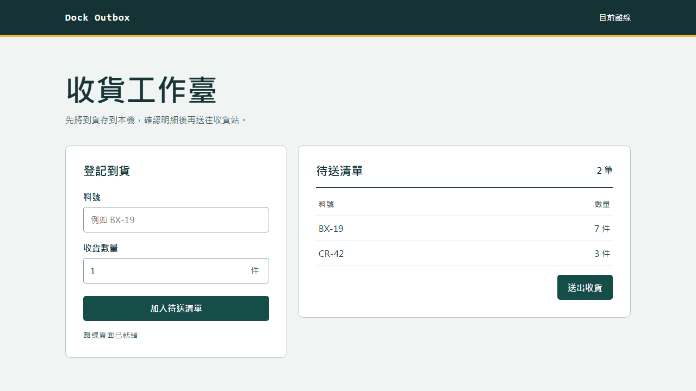

# Dock Outbox｜離線收貨工作臺

卸貨區連線不穩，收貨員先登記兩箱物料。第一筆送到收貨站時，伺服器已經入帳，瀏覽器卻沒有收到確認。Dock Outbox 把每次登記的識別碼和資料保存在 IndexedDB，重送同一筆時可取回原收據。另一批同料號、同數量的到貨仍可獨立入帳。



## 在本機操作

需要 Node.js 24 以上。在專案目錄執行以下命令，再開啟終端機顯示的 `http://127.0.0.1:4186`。

```sh
npm ci
npm start
```

1. 第一次連線開啟，等畫面顯示「離線頁面已就緒」。登記料號 `BX-19`、數量 7，按「加入待送清單」。
2. 停止本機伺服器。在同一個瀏覽器、同一個網址重新開頁，登記 `CR-42`、數量 3。清單會留下兩筆。
3. 在同一個專案目錄再執行一次 `npm start`，按「送出收貨」。收到確認後會顯示「已確認 2 筆收貨」。

暫存資料屬於目前瀏覽器與網址，清除網站資料會移除待送紀錄。Service Worker 快取操作頁面，IndexedDB 保存待送清單。伺服器只監聽本機回送位址，入帳資料存於 `.dock-data/receipts.sqlite3`。可用 `DOCK_DB` 指定其他資料庫路徑。

## 何時能從待送清單移除

| 伺服器或網路結果 | 工作臺行為 |
| --- | --- |
| 新識別碼成功入帳，HTTP 201 | 核對回覆的識別碼、料號和件數，符合才移除該筆 |
| 相同識別碼與內容重送，HTTP 200 | 取回原收據，核對後繼續送下一筆 |
| 同一識別碼的件數或料號不同，HTTP 409 | 停下並將焦點移到雙方料號與件數的說明。核對後按 Tab 移至採用按鈕，再按 Enter 移除此筆 |
| 斷線、逾時或回覆內容不符 | 保留尚未確認的項目，下次按原順序重送 |

SQLite 用唯一主鍵處理重送。同一料號可以收貨多次，每次獨立登記都有新的識別碼。同一瀏覽器的其他分頁透過 BroadcastChannel 更新清單。跨分頁或回覆遺失時可能發出多次 HTTP 請求，唯一識別碼讓相同操作只入帳一次。[本機佇列](public/outbox.js) · [伺服器入帳](receipts.mjs)

## 自動化驗證

```sh
npx playwright install chromium firefox
npm test
```

每個案例使用獨立 Node 伺服器與暫存 SQLite 資料庫。Playwright 在 Chromium 與 Firefox 分別執行四個案例。

- 離線關閉分頁、重開並讀回兩筆。測試讓第一筆真的入帳後丟棄回覆，再送一次，依序核對 HTTP 201、200、201 與資料庫的兩列。
- 三筆收貨中，第二筆的本機 6 件與已入帳的 2 件衝突。核對時第一筆已確認，第三筆仍保留。採用 2 件後，第三筆可繼續送出。
- 在 360 像素寬的畫面與另一個分頁各自登記同一料號 7 件。兩個獨立操作入帳成兩筆，兩個分頁最後都看到空清單。
- 在兩個分頁核對同一筆 6 件與 2 件的衝突。在其中一頁用鍵盤採用 2 件，兩頁的核對區都收起，焦點回到料號欄位，資料庫只保留原收據。若還有待送項目，則回到送出按鈕。

[瀏覽器整合測試](tests/receiving.spec.js) · [GitHub Actions](.github/workflows/ci.yml)

本作品使用 AI 輔助開發，收貨情境與數字來自合成測試。
