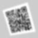

# Table Scan Check｜點餐桌牌掃碼驗收

桌牌即使掃得開，也可能把 A01 的客人帶到 A02。這個離線驗收工具讀取每桌的 QR 圖片與預期網址，以 OpenCV 模擬不同取像條件，再用 ZXing-C++ 解碼，逐位元組比對網址。將套印或排版後的圖檔依**印在桌牌上的桌號**配對，便能在交付前找出錯桌、無法辨識或一張圖內有多個 QR Code 的情況。

## 重跑八桌驗收

使用 Python 3.12，在專案根目錄執行下列指令。`examples` 已附八張從禾日食堂列印頁面擷取的 QR 圖，預期網址使用保留的 `.example` 示範網域。

```sh
python -m pip install -r requirements.txt
python scan.py examples/manifest.json --failures scan-results
python -m unittest -v
```

| 擷取條件 | 圖片投影前寬度 | 結果 |
| --- | ---: | --- |
| 正拍 | 180 px | 8/8 符合桌號與網址 |
| 縮小 | 128 px | 8/8 符合 |
| 斜拍，加入 0.7 px 高斯模糊 | 180 px | 8/8 符合 |
| 低解析度斜拍，加入 1.2 px 高斯模糊 | 56 px | 0/8 可讀，保存 8 張診斷圖 |

A03 的斜拍輸入與低解析度輸入如下。圖中為解碼器實際收到的像素。[斜拍原圖](docs/angled.png) · [低解析度原圖](docs/low-resolution.png)

　

這 32 次結果來自固定圖片、投影和解碼器。紙面反光、鏡頭對焦和不同手機的表現，仍需拿實體桌牌現場量測。

## 換成自己的桌牌

### 驗收送印的 PDF

點餐頁匯出的 [兩頁 A4 樣張](examples/tables.pdf) 每頁有四桌。用下列指令可直接驗收整份樣張。

```sh
python scan_sheet.py examples/tables.pdf examples/sheet-layout.json
```

工具以 PDFium 將每頁轉為 144 DPI 影像，在整頁找出可解碼的 QR，再依四個角的位置歸到桌牌。隨附樣張的八桌皆符合預期。測試將第一頁 A01、A02 的 QR 像素互換，保留原桌號文字，驗收會逐桌列出兩個錯誤目的地。若只留下第一頁，報表會列出缺少的 A05 到 A08。多出空白頁也會因頁數不符而失敗。

換版時，在 [版面清單](examples/sheet-layout.json) 依印刷設計指定各桌所在頁與區域。`pages` 依印刷頁序排列，`bounds` 依序為左、上、右、下，數值是距頁面左側或頂端的比例（0 到 1）。每桌必須剛好分配一次，區域不得重疊。`manifest` 指向獨立的桌號與網址清單。跨過區域邊界或落在區域外的有效碼會列入 `unexpected`。程式核對位置與編碼內容，印在紙上的桌號文字仍需校稿。結束碼與圖片驗收相同。[整頁驗收程式](scan_sheet.py) · [錯桌、跨界與缺頁測試](test_sheet.py)

### 驗收個別影像

複製 [manifest.json](examples/manifest.json)，將每桌的 `image` 改為 QR 區域圖片路徑，`expected` 填入該桌應前往的完整網址。相對路徑以這份清單所在的目錄為準。資料可使用 8-bit PNG 或 JPEG；透明像素會合成到白底。預期網址應取自桌位清單，獨立於圖片解碼結果。程式不會開啟掃出的網址。

每種條件可設定投影前寬度 `width_px`、透視偏移比例 `tilt`（0 至 0.4）、高斯模糊標準差 `blur_sigma`（像素）與是否必須可讀 `required`。透視偏移是以圖寬、高計算的變形比例。保留至少一項必要條件。

| 結果 | 如何判定 |
| --- | --- |
| `matched` | 唯一讀出的 QR 資料與該桌預期網址完全相同。 |
| `wrong_target` | 只讀出一個碼，但內容不同。報表同列預期與實際值。 |
| `ambiguous` | 同一張輸入讀出多個碼。即使其中一個正確，也列為失敗。 |
| `unreadable` | 沒有有效解碼。必要條件會失敗；選填壓力條件只記錄結果。 |

結束碼 **0** 代表通過，**1** 代表有阻擋交付的結果，**2** 代表輸入或輸出錯誤。錯桌及多碼在任何條件都會阻擋交付。加上 `--failures 新目錄` 可保存 `report.json` 和每個未符合項目的實際圖檔。JSON 也會印在標準輸出。

## 用真正的點餐頁重新產生圖檔

整合演練使用 Node.js 24、Chromium 與固定版本的禾日食堂。在下列命令執行前，依上方步驟安裝 Python 相依套件。

```sh
npm ci --prefix ../.. --include=optional
npm run build --prefix ../..
npm ci --prefix ../../qa
cd ../../qa
npx playwright install chromium
cd ../modules/table-scan-check
node capture.mjs ../.. freshly-printed
python scan.py freshly-printed/manifest.json
python scan_sheet.py freshly-printed/tables.pdf freshly-printed/sheet-layout.json
```

擷取程式以 Miniflare 執行點餐網站的 Worker 與靜態資產，Chromium 在列印樣式下開啟 `/tables`。它依頁面桌號定位 QR 圖，核對桌邊菜單連結，再擷取該桌從 `/api/qr` 載入的影像。擷取期間瀏覽器請求只送往本機模擬的網站。中央 CI 建置網站後擷取新圖並核對既有範例，案例包含交換 A01、A02，以及同一張照片同時入鏡兩個不同桌碼。[頁面擷取](capture.mjs) · [影像驗收](scan.py) · [測試](test_scan.py)
